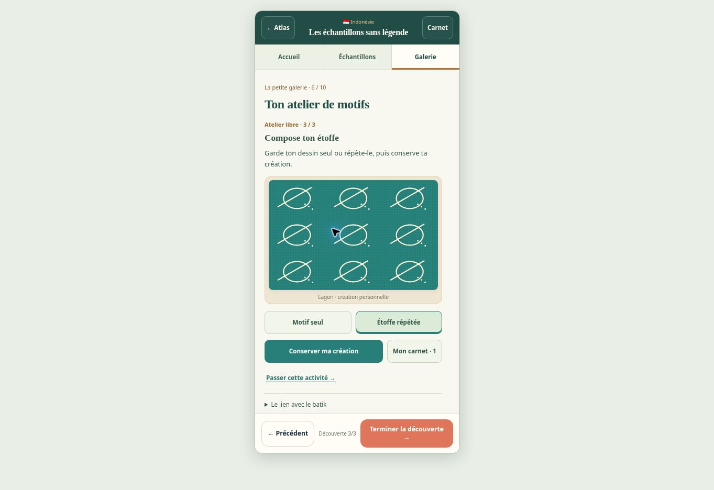

# Atelier Indonésie — contrôle v5.1.0

## Comportement livré

Une découverte facultative en trois étapes permet de tracer un motif personnel, essayer quatre couleurs puis conserver un motif seul ou répété. Le carnet contient au plus 24 créations avec navigation, agrandissement, téléchargement SVG, reprise et retrait annulable. L’essai courant et les créations sont inclus dans la progression locale et les sauvegardes JSON. Une ancienne aventure v5.0 conserve son écran et ses choix sans inventer un dessin.

## Vérifications

- Assemblage des données et vérification des ressources du cache hors connexion.
- Régressions du carnet de recettes, du passeport, de l’Inde et des anciennes rencontres.
- 288 parcours des nouvelles aventures et 48 parcours par les commandes affichées.
- Test dédié de l’atelier : outils, événements de pointeur, couleurs, répétition, sauvegarde, doublons, reprise, rejeu, fusion, données importées invalides et sauvegarde dense de plus de 1 Mio.
- Chrome sur ordinateur : tracé par glisser, ajout de points et d’une boucle, changement de couleur, répétition, conservation, carnet et agrandissement.
- Cadre de 390 × 844 px dans le même navigateur : largeur de contenu égale à 390 px, lieux et navigation inférieure visibles, carnet et agrandissement utilisables.

Le dessin visible est un exemple réalisé pendant le contrôle, sans valeur de motif traditionnel. La prise de vue contient le cadre de test autour de l’application.

## Limites du contrôle

Aucun téléphone physique n’a été utilisé. La capture de l’événement de téléchargement par l’automatisation du navigateur a expiré sans fournir de chemin de fichier ; le test sans navigateur valide le SVG produit, son type et son nom de téléchargement. Les erreurs de console observées pendant le contrôle mobile venaient de l’extension d’automatisation, sans erreur de l’application. L’impression des recettes et les lecteurs externes n’ont pas été revérifiés dans cette évolution.

## Source culturelle

[UNESCO · Le batik indonésien](https://ich.unesco.org/fr/RL/le-batik-indonsien-00170), principe de la cire qui résiste à la teinture, revérifié le 21 octobre 2026 à partir de la description officielle indexée. L’atelier propose une création libre qui aide à observer ce principe ; il ne constitue pas un apprentissage du métier du batik.
