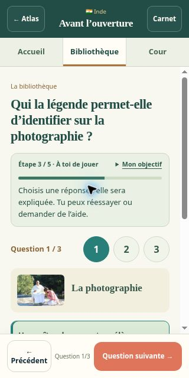

# Des aventures plus faciles à suivre — v5.3.0

La demande signalait un objectif et des actions difficiles à comprendre. Les 18 aventures suivent désormais un fil guidé : rencontre, découvertes, activité facultative et questions, choix de l’accueil, scène finale. Les trois lieux restent accessibles, avec une consigne au-dessus du visuel et un objectif consultable à tout moment.

Les récits ne reposent plus sur des légendes décollées à remettre en place. La question en cours apparaît dans le titre, avant l’image. Les questions portent sur des éléments concrets de la découverte : ce que l’on voit, un geste ou un principe, les personnes qui transmettent. Chaque réponse affiche immédiatement son explication ; l’aide montre la bonne réponse et permet de poursuivre. La lecture des documents ne demande plus un clic préalable d’ouverture. Une activité peut être passée avant de l’ouvrir.

Les 51 questions du moteur commun sont intégrées aux fichiers JSON des aventures et validées par `tools/build-world-data.cjs`. Les trois questions de l’Inde restent dans son moteur dédié. Les repères documentaires, photographies et crédits préexistants sont conservés. Les contenus nouveaux reformulent ces mêmes repères ; les dossiers UNESCO du yoga, du batik, du kimjang, des dessins sur le sable, du flamenco, du ceebu jën, du sauna, du ger et du tissage ont été consultés pour recouper les formulations lors de cette évolution.

## Vérifications

- Validation des données et concordance des fichiers assemblés avec les deux commandes `tools/build-*.cjs --check`.
- `tests/world-adventures.cjs` : 408 parcours libres dans les six ordres d’exploration, 68 parcours par les commandes affichées, raccourci de l’activité facultative dans les 17 escales du moteur commun, aide directe, réponses indépendantes et reprise d’un tableau ancien correct mais non validé.
- `tests/notebook.cjs` : 24 parcours indiens, quatre parcours par les commandes affichées, raccourci de la pause, aide directe, reprise et sauvegardes ; recettes, quiz et anciens carnets également contrôlés.
- `tests/batik-workshop.cjs`, `tests/expansion.cjs` et `tests/service-worker.cjs` : créations, fusion des sauvegardes, cinq nouvelles escales et mise à jour du cache malgré une ancienne réponse HTTP.
- Contrôle du navigateur : un parcours espagnol jusqu’à sa scène finale dans une fenêtre de 390 × 844 px ; photo, documents, activité passée, essai incorrect, aide, trois questions et choix repris dans le résultat. Sur une fenêtre de 320 × 640 px, contrôle de l’Inde, de l’objectif déplié et du passage direct aux questions avec aide.

Les mesures du navigateur donnent une largeur de contenu de 390 px puis 320 px, sans débordement horizontal. Les commandes du bas restent entièrement dans chaque fenêtre. Les fenêtres mobiles sont des iframes de contrôle ; aucun téléphone physique n’a été utilisé. Les liens vidéo restent facultatifs et n’ont pas été recontrôlés par lecture intégrale.

La version d’application, le manifeste de mise à jour et le cache passent ensemble à 5.3.0. La clé de progression locale et les identifiants des aventures restent inchangés. Les sauvegardes antérieures restent lisibles, notamment les réponses et souvenirs des aventures terminées et le carnet de créations indonésiennes.

