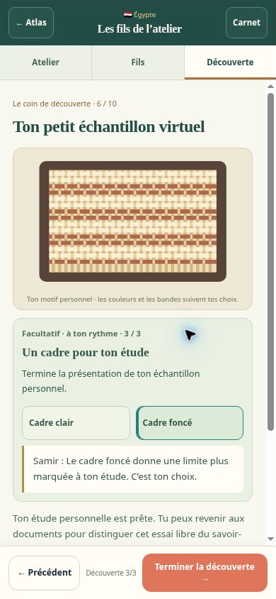
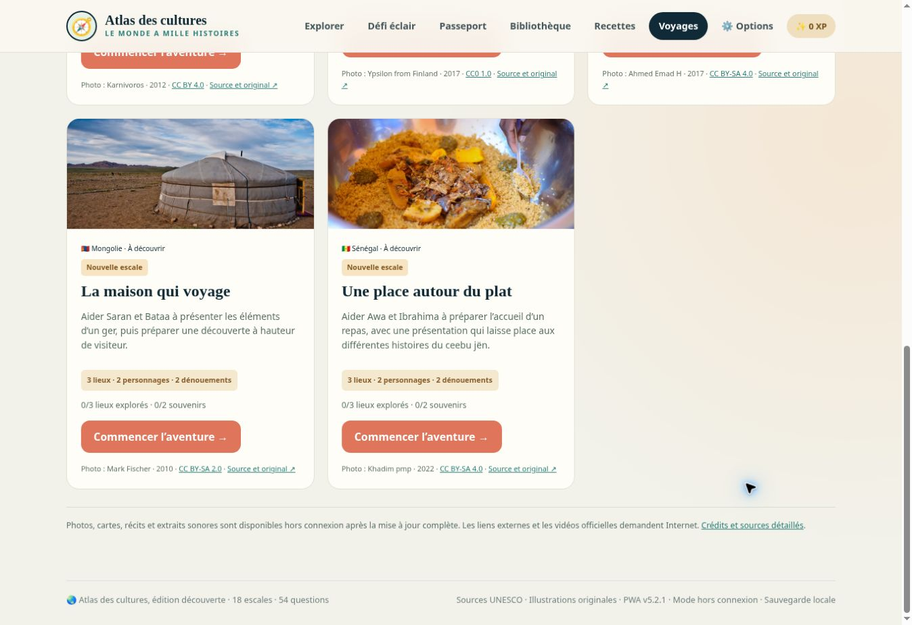

# Cinq nouvelles escales — v5.2.0

Évolution préparée le 1er novembre 2026 depuis `main`, commit `37b79e18cd5d68cbabe65febe7a138775cdcb3a6` (atelier personnel indonésien, v5.1.0).

## Inventaire avant ajout

Les 13 identifiants existants sont conservés. Aucun des cinq ajouts ne figure dans cet inventaire.

| Escale | Tradition |
| --- | --- |
| Japon | Washoku |
| Corée du Sud | Kimjang |
| Viet Nam | Chants Quan Họ |
| Indonésie | Batik et atelier personnel de motifs |
| Inde | Yoga et découverte facultative |
| Vanuatu | Dessins sur le sable |
| Türkiye | Café turc |
| Géorgie | Kvevris |
| Maroc | Conteurs de Jemaa el-Fna |
| Kenya | Danse isukuti |
| Mexique | Cuisine du Michoacán |
| Brésil | Roda de capoeira |
| Pérou | Pont Q’eswachaka |

## Choix complémentaires

| Ajout | Apport à l’Atlas | Découverte facultative |
| --- | --- | --- |
| Espagne | Première escale en Europe occidentale ; flamenco et transmission associative | Composer une invitation en trois choix et découvrir le documentaire musical à la demande |
| Finlande | Première escale nordique ; patrimoine du quotidien | Imaginer une carte d’accueil autour d’un lieu et de souvenirs |
| Égypte | Première escale d’Afrique du Nord-Est ; tissage du Sa’eed | Composer un échantillon virtuel avec couleurs, bandes et cadre |
| Mongolie | Première escale d’Asie intérieure ; artisanat d’un habitat mobile | Faire apparaître structure, enveloppe et liens sur une maquette de ger |
| Sénégal | Première escale d’Afrique de l’Ouest ; cuisine et hospitalité | Préparer l’accueil d’un repas puis ouvrir la recette illustrée de ceebu jën |

Chaque ajout réutilise le moteur commun : trois lieux visibles dès l’introduction, deux personnages, une photographie documentaire, deux repères sourcés, une énigme par associations, une activité optionnelle et deux dénouements. Deux préparatifs par dénouement permettent quatre variantes finales. L’activité reste facultative pour terminer la mission.

Les notices et décisions UNESCO ainsi que les sources complémentaires sont référencées dans [les sources des aventures](../travel/adventures/SOURCES.md). Les photographies ont leurs légendes, auteurs et licences dans [les crédits](../travel/CREDITS.md). Les illustrations narratives existant dans les fichiers de travail ont été réutilisées avec leur provenance du 31 octobre ; elles ont été inspectées avant intégration.

## Intégration

Les cinq fiches et quiz sont assemblés par `tools/build-expansion.cjs`. Les données des aventures sont assemblées par `tools/build-world-data.cjs`. Le résultat porte le total à 18 escales et 54 questions. Les nouveaux scripts sont chargés avant l’initialisation des sauvegardes, afin que leurs identifiants soient reconnus à l’import et au rechargement.

Les filtres par région et avancement, la recherche sans accents, le bouton « 5 nouvelles », la reprise de l’aventure en cours et les compteurs adaptatifs accompagnent l’extension. Le passeport SVG adapte sa hauteur aux 18 tampons. Le cache v5.2.0 comprend les cinq photographies, les dix illustrations et la fiche PDF sénégalaise.

La clé de sauvegarde reste `atlas-cultures-save-v1`. Les anciens dialogues et progrès restent lisibles ; l’atelier et le carnet indonésiens sont conservés. La restauration fusionne les souvenirs sans remplacer une aventure locale commencée.

## Vérification

Contrôles automatisés réussis :

- `node tools/build-world-data.cjs --check` et `node tools/build-expansion.cjs --check` : schémas, 18 identifiants uniques, 54 questions et concordance des fichiers assemblés.
- `node tests/world-adventures.cjs` : 408 parcours dans six ordres d’exploration et 68 parcours par les commandes rendues ; un seul visuel par carte ; activités suivies ou passées ; reprise, import et conservation des anciens progrès.
- `node tests/notebook.cjs` : passeport, quiz, fiches, anciennes rencontres, aventure indienne, recettes, portions et présence des ressources hors connexion.
- `node tests/batik-workshop.cjs` : tracés, couleurs, répétition, créations, retrait annulable et fusion des sauvegardes indonésiennes.
- `node tests/expansion.cjs` : cinq nouvelles séries de quiz, filtres, recherche sans accents, reprise du voyage, activités visuelles, recette sénégalaise et export des 18 tampons sans chevauchement.
- `node tools/export-recipe-data.cjs` : 18 escales et cinq recettes reconnues par l’outil de génération PDF.
- `git diff --check` : aucune erreur d’espacement.

Le PDF du ceebu jën a été rendu et inspecté : une page A4, avec image, ingrédients, préparation et références lisibles.

Le navigateur a contrôlé la carte des 18 destinations, le filtre « 5 nouvelles », le tissage et l’invitation espagnole dans une fenêtre de 390 × 844 pixels, ainsi que la maquette mongole dans une fenêtre de 320 × 640 pixels. Ces fenêtres sont des iframes de contrôle du site. Les contrôles du lecteur restent dans la fenêtre et la largeur du contenu correspond à la largeur disponible, sans débordement horizontal. Le rechargement puis le bouton de reprise ont restitué le tissage, ses couleurs, ses bandes et son cadre.

Limites : aucun téléphone physique n’a été utilisé. L’ancien test navigateur `tests/recipes.cjs`, prévu pour Edge, n’a pas pu démarrer car Edge n’est pas installé ; ses nombres et destinations ont été actualisés. Les parcours de recettes et de sauvegarde ont été contrôlés par les tests sans navigateur et le navigateur disponible.

## Correctif de publication — v5.2.1

Le contrôle sur GitHub Pages après une installation de v5.1.0 a montré que la bannière v5.2.0 pouvait laisser la page à 13 escales après activation. Le préchargement utilisait les URL avec la politique HTTP par défaut, qui autorise la réutilisation de réponses encore fraîches. Le nouveau cache porte le numéro v5.2.1 et précharge des objets `Request` avec `cache: reload` pour récupérer les fichiers de la nouvelle édition. La progression locale reste indépendante des caches.

Références : [MDN · Request.cache](https://developer.mozilla.org/en-US/docs/Web/API/Request/cache) et [MDN · Cache.addAll](https://developer.mozilla.org/en-US/docs/Web/API/Cache/addAll). Le test `node tests/service-worker.cjs` vérifie l’installation malgré un cache HTTP ancien, la navigation hors connexion, les fichiers servis et la conservation des caches étrangers à l’Atlas.

Le correctif a ensuite été vérifié sur l’adresse HTTPS habituelle : depuis la page conservée en v5.1.0, « Rechercher une mise à jour » puis « Mettre à jour » ont affiché v5.2.1, 18 escales et 54 questions. Le filtre « 5 nouvelles » a retourné exactement Espagne, Finlande, Égypte, Mongolie et Sénégal. Le déploiement GitHub Pages du correctif est terminé avec succès.

